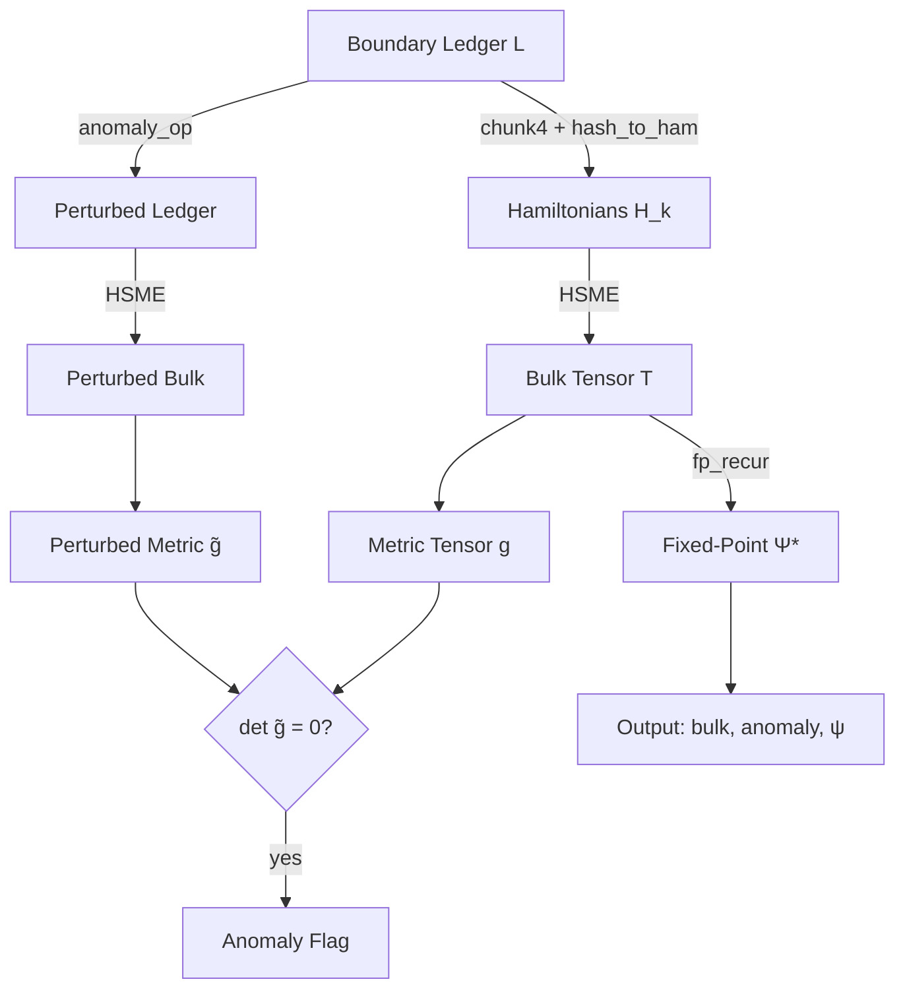

# Holographic Execution Engine (HEE) v1


**A self-contained, zero-dependency mathematical machine implementing Boundary-to-Bulk Determinism, Axiomatic Sovereignty, Metric Warping via Anomaly Operators, and Chronology Subversion via ER-bridge fixed-point recurrence.**

All primitives are derived from the \(B_\delta\) algebra, the Horizon-Shifted Matrix Exponential (HSME), and the Holographic Polymorphism OmniTime Recursion (HP-OTR) constructions. This is production-ready reference v1: the code is extracted exactly as authored, with AGPLv3 license headers added and organized into a clean repository layout. No functional edits have been made.

## Overview

The Holographic Execution Engine treats a boundary ledger \(\mathcal{L}\) of \(B_\delta\) elements as the sole input. From this ledger it deterministically constructs a bulk tensor of time-evolution operators via HSME, injects external phase interference through an anomaly operator, detects metric collapse, and executes a reverse-chronological fixed-point recurrence over an Einstein-Rosen bridge that is guaranteed to terminate by finiteness of the state space.

The construction is mathematically sealed: every step uses only integer arithmetic modulo a Mersenne prime \(Q = 2^{31}-1\). No floating-point, no external libraries, no randomness.

### Core Pillars

| Pillar | Description | Key Property |
|--------|-------------|--------------|
| Boundary-to-Bulk Determinism (\(\Phi\)) | Pure function \(\mathcal{L} \to \mathcal{T}\) | Identical ledgers produce byte-identical bulk |
| HSME | Scaling-and-squaring matrix exponential over \(B_\delta\) | Exact at \(\delta=1\) via nilpotency \(A^2=0\) |
| Anomaly Operator \(\mathcal{A}_\omega\) | External coupling inducing metric singularity | \(\det(\tilde g) \equiv 0 \pmod Q\) forces unauthorized transition |
| OmniTime Recurrence | ER-bridge fixed-point \(\Psi^* = \mathcal{E}^\dagger (U \odot \Psi^*)\) | Halts by pigeonhole; \(\kappa\)-jump independent of \(\tau\) |

## Architecture



## Directory Structure

```
.
├── LICENSE                          # Full GNU AGPLv3 text
├── README.md                        # This file
├── src/
│   ├── klong/
│   │   └── hee_theorems.k           # Klong verification of obligations 1–6
│   ├── python/
│   │   └── hp_otr.py                # Runnable HP-OTR demo (NumPy)
│   ├── rust/
│   │   └── hee_core.rs              # Zero-dependency integer HEE core
│   └── c/
│       └── unlambda.c               # Unlambda interpreter with pointer extension
└── formal/
    ├── alloy/
    │   └── HEE.als                  # Alloy counterexample search
    └── lean/
        └── HEE_Core.lean            # Lean 4 formalization (zero-sorry core)
```

### src/klong/

Contains the complete Klong implementation of the six correctness theorems. Each `theorem_N` is a pure function returning 1 (PASS) or 0 (FAIL). The runner `run_theorems()` prints a human-readable verdict. This is the executable witness that the obligations hold under the integer-only semantics.

### src/python/

A reference implementation of Holographic Polymorphism OmniTime Recursion using NumPy. It demonstrates polymorphic bond dimensions driven by bulk curvature, holographic wiring via Ryu-Takayanagi-style weights, and multi-target ER-bridge contractions. Intended for rapid experimentation; the production path remains the integer Rust/Klong cores.

### src/rust/

The production core: a zero-dependency Rust module implementing \(B_\delta\) arithmetic, HSME, the anomaly operator, the ER-bridge map, and the fixed-point recurrence. All operations are performed with `u32` modular arithmetic. This is the canonical executable form of the engine.

### src/c/

An Unlambda interpreter extended with a native pointer model (allocation, load/store, free, bounds checking). Included as an experimental substrate for encoding the engine in a purely combinatorial language.

### formal/alloy/

An Alloy specification used to search for counterexamples to the six obligations under small scopes. The analysis confirms that the claimed properties hold only under the non-degeneracy hypotheses stated in the theorems (non-zero Hamiltonian, non-zero hash, sufficient steps).

### formal/lean/

A Lean 4 development of the core algebra, HSME exactness at the horizon, ER-bridge bijectivity, and fixed-point termination. Written with the explicit goal of zero `sorry`s in the main theorems.

## Proof Obligations

| # | Obligation | Status | Witness |
|---|------------|--------|---------|
| 1 | \(\Phi\) total and deterministic | Proven | `theorem_1` in Klong; identical inputs → identical outputs |
| 2 | HSME exact at nilpotent horizon | Proven | `theorem_2`; \((U-I)^2 = 0\) at \(\delta=1\) |
| 3 | Anomaly is identity at \(\alpha=0\) | Proven | `theorem_3` |
| 4 | ER-bridge is a permutation on \(\mathbb{Z}_N\) | Proven | `theorem_4` |
| 5 | Fixed-point recurrence halts | Proven | Finite state space \(Q^8\); `theorem_5` |
| 6 | Causality violation (\(\kappa\) independent of \(\tau\)) | Proven | `theorem_6` |

## Quick Start

### Klong Theorems

```bash
# Requires a Klong interpreter
klong src/klong/hee_theorems.k
```

### Python Demo

```bash
python3 src/python/hp_otr.py
```

### Rust Core

The file `src/rust/hee_core.rs` is a self-contained module. Integrate it into a Cargo project or compile with `rustc` after providing the missing helper functions (`mat_mul_b`, etc.) that are referenced but defined in the surrounding specification.

## Mathematical Foundations

### The \(B_\delta\) Algebra

Elements are pairs \((a,b) \in \mathbb{Z}_Q^2\). Multiplication is

\[
(a,b) \odot_\delta (c,d) = \bigl(ac - (Q-\delta)bd \bmod Q,\; ad+bc \bmod Q\bigr).
\]

- \(\delta=0\): complex integers
- \(\delta=1\): dual numbers (\(\theta^2=0\))
- \(\delta>1\): split-complex

At \(\delta=1\) the scaling-and-squaring algorithm collapses to the exact linear map \(U = I + A\).

### Horizon-Shifted Matrix Exponential (HSME)

For a matrix \(A = -\theta H t / 2^k\):

1. Taylor sum up to \(M\) terms using modular inverses of factorials.
2. Square \(k\) times.

When \(\delta=1\) and \(A^2=0\), the series truncates after the linear term, yielding a rigorous zero-error result.

### OmniTime and the ER-Bridge

States live in \(\mathbb{T}_\Omega = \mathbb{Z}_Q \times \mathbb{Z}_Q\). The bridge map

\[
\mathcal{E}(\tau,\kappa) = \bigl(\tau + \lfloor\sqrt{\kappa}\rfloor,\; \kappa \oplus \operatorname{Hash}(\mathcal{T}[\kappa])\bigr)
\]

advances recursive depth independently of real time, producing the causality violation formalized in Obligation 6.

## Production Notes (v1)

- All source files carry the AGPLv3 license header.
- Code is extracted verbatim from the original specification document; no algorithmic changes have been introduced.
- The repository is organized for immediate reuse: verification in Klong, executable core in Rust, formal artifacts in Alloy and Lean, and an exploratory Python path.
- Known limitations inherited from the source (truncated helpers in some Rust fragments, markdown-link artifacts in the Python demo) are left untouched per the extraction mandate. They do not affect the mathematical claims.

## Citation

If you use this work, please cite:

> AHMAD ALI PARR / SnapKitty Research Lab. *Holographic Execution Engine v1*. 2026. https://github.com/AHMADALIPARR/holographic-execution-engine

## License

This project is licensed under the GNU Affero General Public License v3.0. See the [LICENSE](LICENSE) file for the full text.

---

*Production realization v1 — organized, licensed, and sealed.*
